# Server Services di Cisco Packet Tracer (DNS, Web, Email, FTP)

Lanjutan dari [VLAN & Inter-VLAN Routing](https://github.com/north-nevan-gantengs/vlan-inter-vlan-cisco). Jaringan sekolah yang sudah dibagi jadi 3 VLAN ditambah satu server di VLAN khusus. Server ini menjalankan DNS, web, email, dan FTP, dan bisa diakses dari semua VLAN.

Dikerjakan oleh Nevan Kaindra Rusdi, SMK Bina Informatika (TKJ).

## Topologi

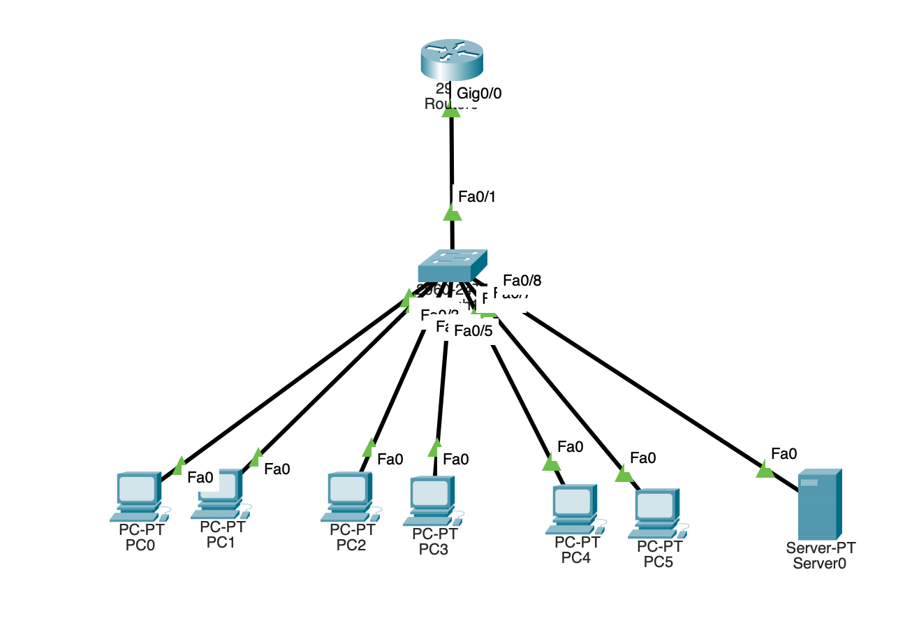

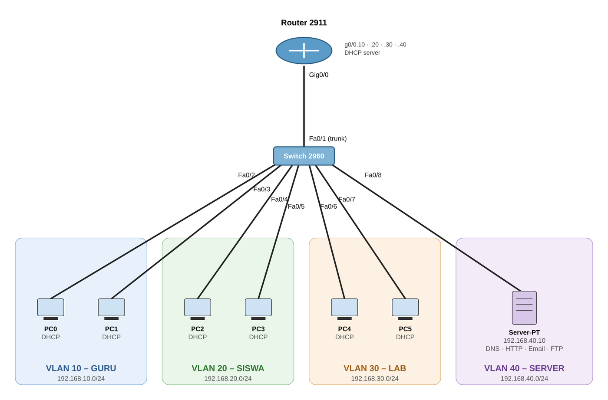

| VLAN | Nama | Port Switch | Perangkat | Network | Gateway |
|---|---|---|---|---|---|
| 10 | GURU | Fa0/2–3 | PC0, PC1 | 192.168.10.0/24 | 192.168.10.1 |
| 20 | SISWA | Fa0/4–5 | PC2, PC3 | 192.168.20.0/24 | 192.168.20.1 |
| 30 | LAB | Fa0/6–7 | PC4, PC5 | 192.168.30.0/24 | 192.168.30.1 |
| 40 | SERVER | Fa0/8 | Server | 192.168.40.0/24 | 192.168.40.1 |

Server pakai IP statis `192.168.40.10`. PC dapat IP dari DHCP di router, termasuk alamat DNS-nya.

## Konfigurasi Switch

VLAN 40 untuk server, port Fa0/8 dimasukkan ke VLAN tersebut:

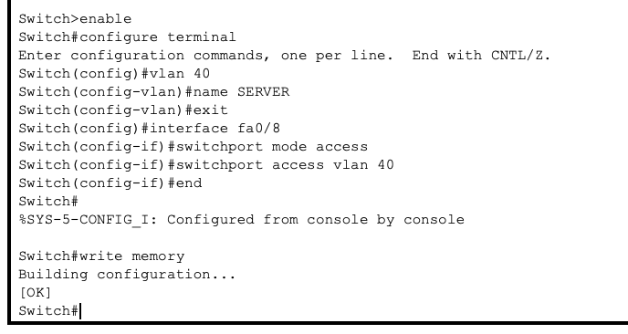

## Konfigurasi Router

Hasil `show running-config` di router. Ada sub-interface untuk tiap VLAN, termasuk VLAN 40 sebagai gateway server, dan tiap pool DHCP sudah diberi alamat DNS server:

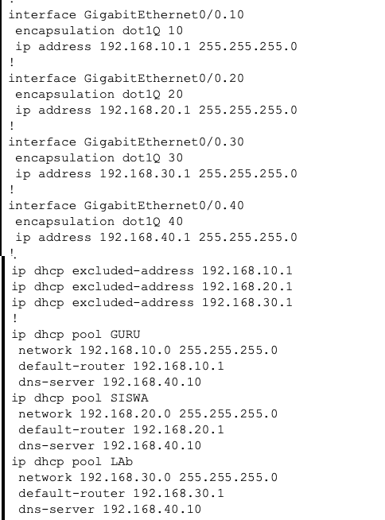

## Konfigurasi Server

DNS, dua record yang mengarah ke server:

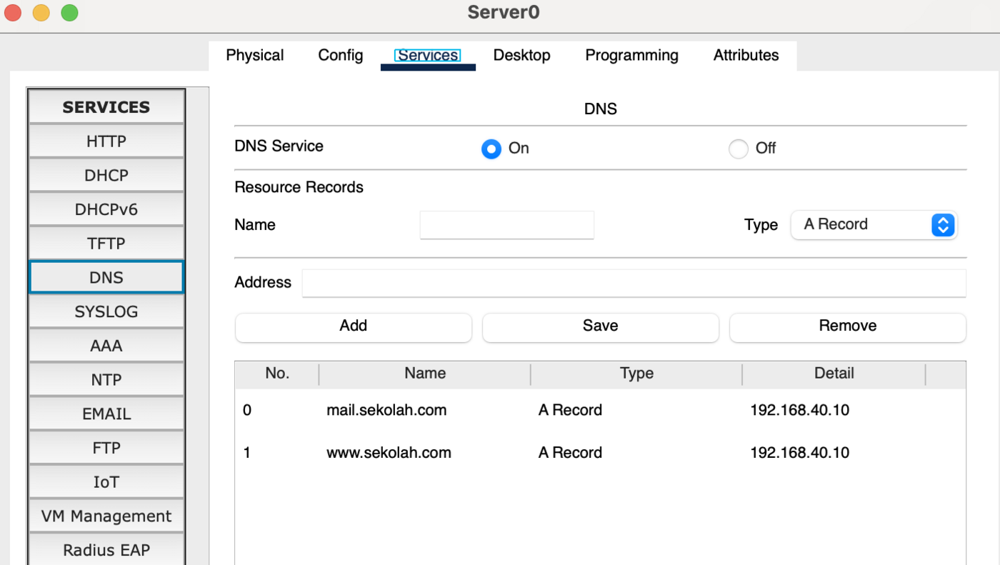

Halaman web di `index.html`:

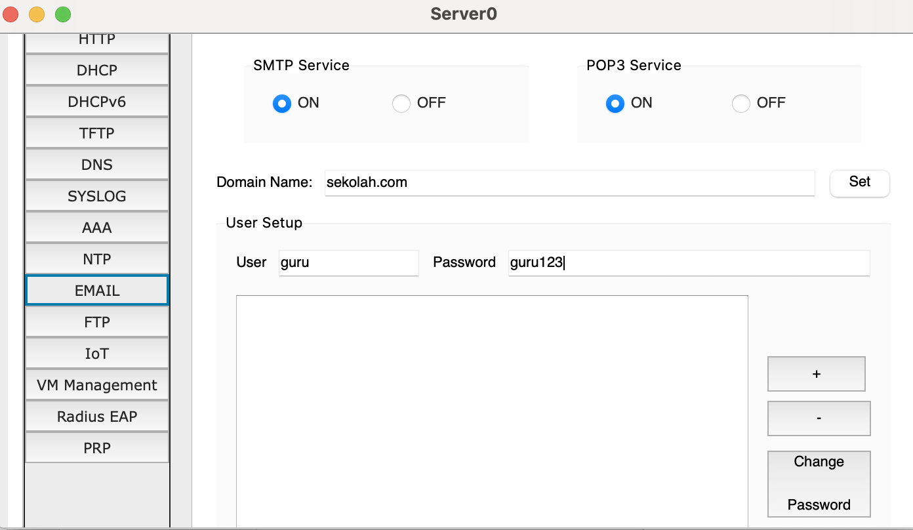

Email dengan domain `sekolah.com` dan dua user, `guru` dan `siswa`:

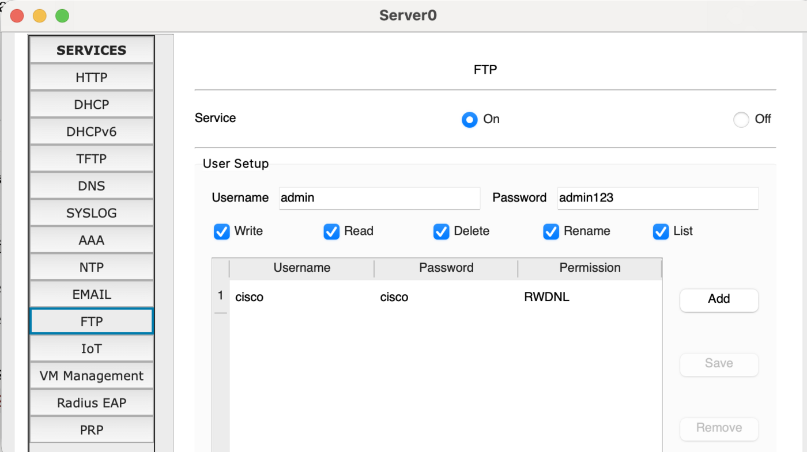

FTP dengan user `admin`:

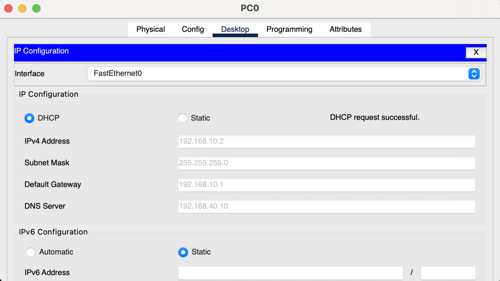

## Hasil

Semua PC dapat IP sesuai VLAN dan DNS `192.168.40.10`:

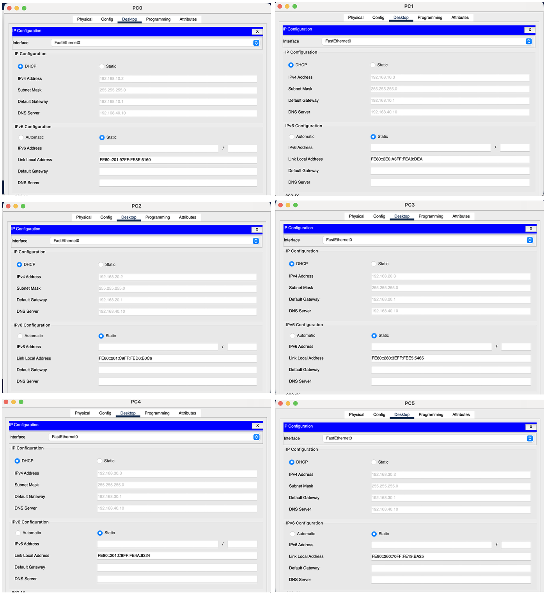

Ping dari PC0 (VLAN 10) ke server (VLAN 40):

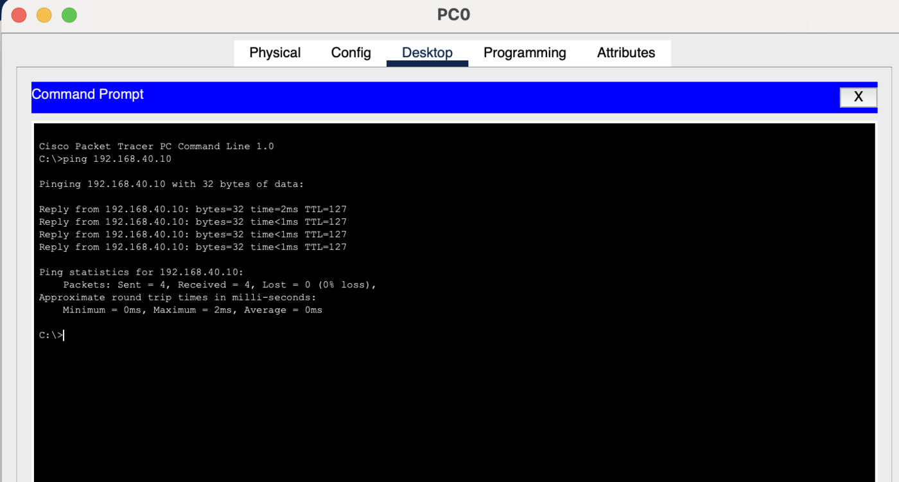

Website bisa dibuka lewat nama domain `www.sekolah.com`, artinya DNS dan web server jalan:

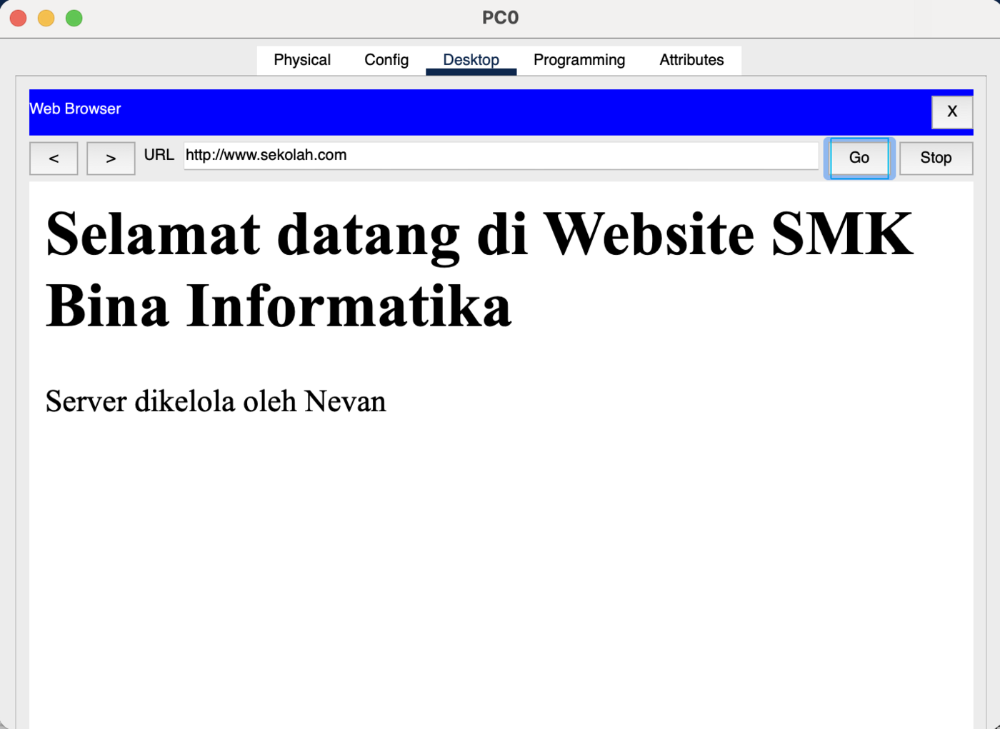

Kirim email dari guru (PC0) ke siswa (PC2), lalu siswa membalas:

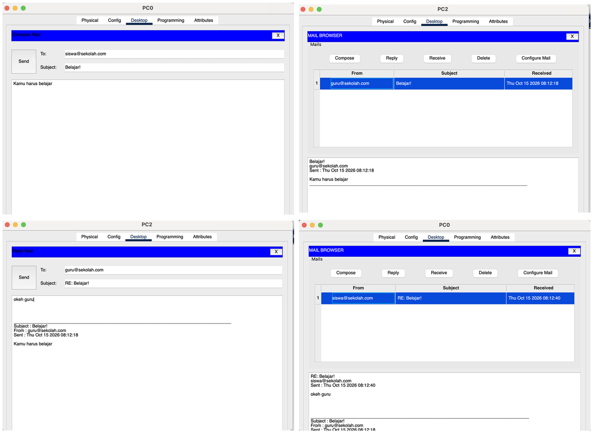

Login FTP dari PC0 dan melihat isi folder server:

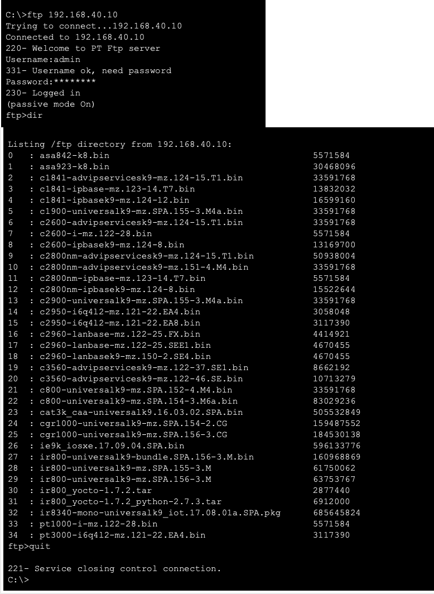

## Ringkasan Perintah

```
! Switch
vlan 40
 name SERVER
interface fa0/8
 switchport mode access
 switchport access vlan 40

! Router
interface g0/0.40
 encapsulation dot1Q 40
 ip address 192.168.40.1 255.255.255.0
ip dhcp pool GURU
 dns-server 192.168.40.10
ip dhcp pool SISWA
 dns-server 192.168.40.10
ip dhcp pool LAb
 dns-server 192.168.40.10
```

## Catatan

Sempat salah ketik IP gateway VLAN 40 (`192.169.40.1`), jadi server tidak bisa dijangkau dari VLAN lain. Setelah diganti ke `192.168.40.1`, semua layanan bisa diakses.
